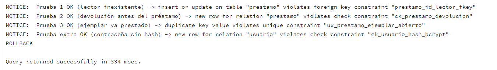
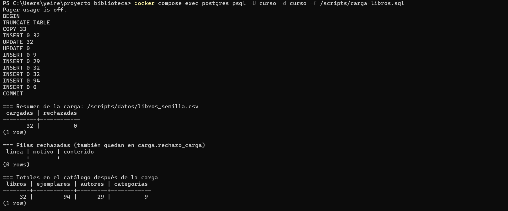
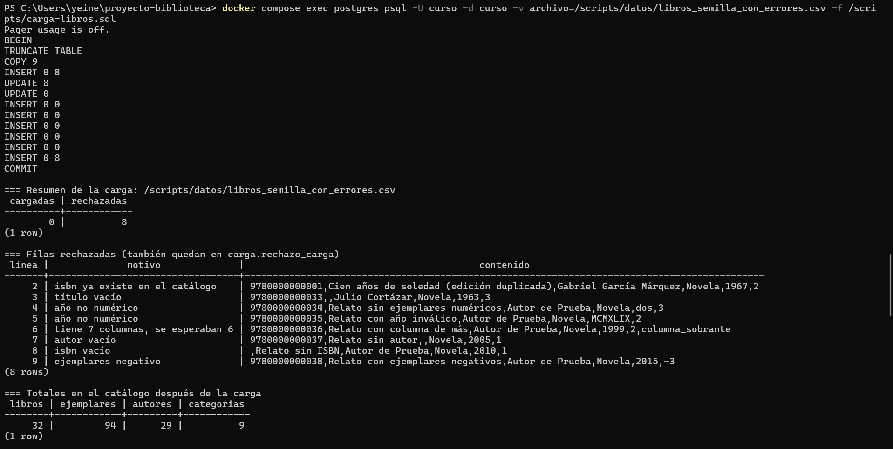
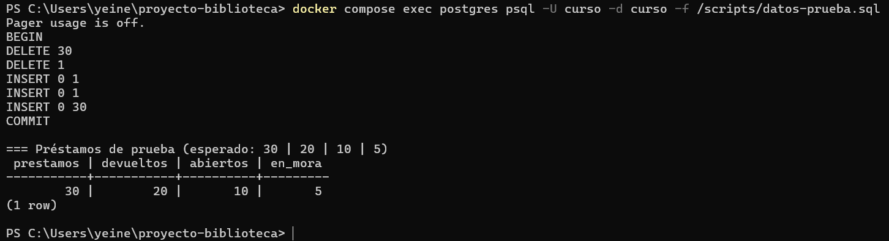
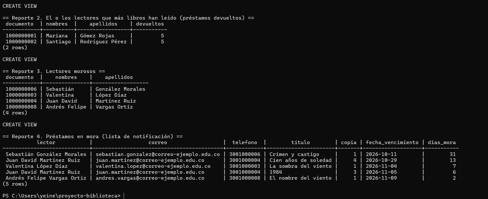
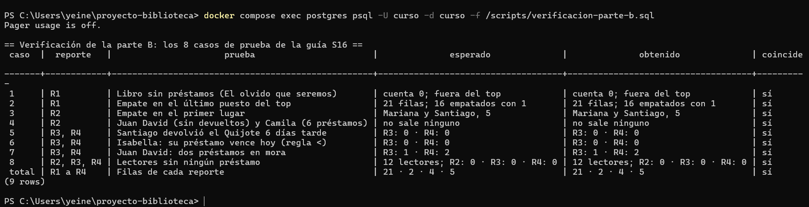

# Sistema de gestión de biblioteca: proyecto integrador

**750006C Bases de Datos · Universidad del Valle**

| | |
|---|---|
| **Grupo** | 9 |
| **Integrantes** | Eisin Yeiner Tobar Bravo · Giovanny Mora Segura |
| **Hito 2** (entregado) | Esquema en PostgreSQL, carga masiva desde CSV (S14), los 4 reportes y el taller de consultas (S15/S16) |
| **Hito 3** (entregado el 24/11/2026) | Documento de normalización, esquema actualizado en `postgres/init/` y migración `normalizacion.sql`; talleres S18, S19 y S20 (S17 a S20) |
| **Hito 4** (en preparación, entrega el 30/11/2026) | Procedimientos `registrar_prestamo` y `registrar_devolucion`, trigger `prestamo_validar` y sus pruebas; talleres S21 y S22 (S21 y S22) |
| **Motor** | PostgreSQL 16 sobre el entorno Docker del curso (probado en Windows con PowerShell 5.1) |

Este README es la **bitácora del proyecto**. Explica qué se hizo, dónde está cada archivo, cómo levantar todo desde cero y qué decisiones se tomaron.

## Mapa rápido por hito

Cada hito tiene sus scripts en `postgres/scripts/hitoN/` y sus documentos en `docs/hitoN/`.

| Hito | Sesiones | Scripts | Documentos | En este README |
|---|---|---|---|---|
| **Hito 2**: esquema, carga desde CSV y los 4 reportes | S14 a S16 | [`postgres/scripts/hito2/`](postgres/scripts/hito2/) (taller S16 en [`taller-S16/`](postgres/scripts/hito2/taller-S16/)) y los CSV en [`postgres/scripts/datos/`](postgres/scripts/datos/) | [`docs/hito2/`](docs/hito2/): mapeo y criterios, evidencias y capturas | Secciones 4 a 9 |
| **Hito 3**: normalización | S17 a S20 | [`postgres/scripts/hito3/`](postgres/scripts/hito3/) (talleres en [`taller-S18/`](postgres/scripts/hito3/taller-S18/), [`taller-S19/`](postgres/scripts/hito3/taller-S19/) y [`taller-S20/`](postgres/scripts/hito3/taller-S20/)) | [`docs/hito3/`](docs/hito3/): **documento de normalización**, evidencias y talleres S18, S19 y S20 | Secciones 10 a 13 |
| **Hito 4**: procedimiento y trigger | S21 y S22 | [`postgres/scripts/hito4/`](postgres/scripts/hito4/) (S21 en [`S21/`](postgres/scripts/hito4/S21/) y taller en [`taller-S22/`](postgres/scripts/hito4/taller-S22/)) y [`postgres/init/03_programacion.sql`](postgres/init/03_programacion.sql) | [`docs/hito4/`](docs/hito4/): respuestas del S22 y evidencias del Hito 4 | Secciones 14 y 15 |
| Comunes | — | [`postgres/init/`](postgres/init/): el esquema y la lógica, que corren solos con la base vacía | [`docs/pendientes.md`](docs/pendientes.md) y [`docs/README-entorno-docker.md`](docs/README-entorno-docker.md) | Secciones 1 a 3 y 16 |

## Contenido

**General**
1. [Estructura del repositorio](#1-estructura-del-repositorio)
2. [Cómo levantar el proyecto desde cero](#2-cómo-levantar-el-proyecto-desde-cero)
3. [Bitácora](#3-bitácora)

**Hito 2 (S14 a S16)**

4. [El esquema `biblioteca`](#4-el-esquema-biblioteca)
5. [La carga desde CSV](#5-la-carga-desde-csv)
6. [CSV propio del grupo](#6-csv-propio-del-grupo)
7. [Prueba de la última línea de defensa](#7-prueba-de-la-última-línea-de-defensa)
8. [Los 4 reportes](#8-los-4-reportes) (incluye el taller S16, en la sección 8.4)
9. [Evidencias](#9-evidencias)

**Hito 3 (S17 a S20)**

10. [Taller S18: formas normales](#10-taller-s18-formas-normales)
11. [Taller S19: esquemas mal diseñados](#11-taller-s19-esquemas-mal-diseñados)
12. [Taller S20: desnormalización para rendimiento](#12-taller-s20-desnormalización-para-rendimiento)
13. [Entrega del Hito 3: normalización del esquema](#13-entrega-del-hito-3-normalización-del-esquema)

**Hito 4 (S21 y S22)**

14. [Talleres S21 y S22: funciones, procedimientos y triggers](#14-talleres-s21-y-s22-funciones-procedimientos-y-triggers)
15. [Lógica en la base de datos (Hito 4)](#15-lógica-en-la-base-de-datos-hito-4)

**Cierre**

16. [Lecciones aprendidas](#16-lecciones-aprendidas)

---

## 1. Estructura del repositorio

La estructura parte del entorno Docker entregado por el profesor (`entorno-docker`), sin cambios en `docker-compose.yml`. Los scripts siguen dentro de `postgres/scripts/`, porque es la carpeta que Docker ve como `/scripts`; adentro están separados por hito. Los scripts del profesor (`S16-tienda.sql`, `S18-automotriz.sql`, `S19-esquemas.sql`, `S20-rendimiento.sql`, `S21-biblioteca-programable.sql` y `S22-reservas.sql`) están sin cambios.

```
proyecto-biblioteca/
├── README.md                          ← esta bitácora (empieza con el mapa por hito)
├── docker-compose.yml                 ← entorno del curso: PostgreSQL 16 + pgAdmin + Node.js
├── postgres/
│   ├── init/                          ← se ejecuta SOLO, una vez, cuando la base está vacía
│   │   ├── 01_esquema.sql             ← esquema "biblioteca" (biblioteca-v2 del S11, revisado en el Hito 3)
│   │   ├── 02_carga.sql               ← esquema "carga": bitácora de rechazos y tablas de paso
│   │   └── 03_programacion.sql        ← Hito 4: funciones, procedimientos y trigger (igual a hito4/programacion.sql)
│   ├── scripts/                       ← se ejecutan a mano (dentro del contenedor: /scripts)
│   │   ├── datos/                     ← 4 CSV semilla del curso + CSV propio del grupo
│   │   ├── hito2/                     ← HITO 2 (S14 a S16)
│   │   │   ├── carga-libros.sql       ← S14: carga de libros desde CSV, con bitácora
│   │   │   ├── carga-lectores.sql     ← S14: carga de lectores desde CSV, con bitácora
│   │   │   ├── pruebas-restricciones.sql ← S11: las restricciones rechazan los INSERT inválidos
│   │   │   ├── datos-prueba.sql       ← S16 parte B: bibliotecaria y 30 préstamos que cubren los 8 casos
│   │   │   ├── reportes.sql           ← S16 parte B: los 4 reportes (guardados como vistas)
│   │   │   ├── verificacion-parte-b.sql ← S16 parte B: tabla de verificación de los 8 casos
│   │   │   └── taller-S16/
│   │   │       ├── S16-tienda.sql     ← esquema de práctica "tienda" (script del profesor)
│   │   │       └── parte-a.sql        ← Parte A: los 11 ejercicios resueltos por el grupo
│   │   ├── hito3/                     ← HITO 3 (S17 a S20)
│   │   │   ├── normalizacion.sql      ← Hito 3: migra una base con datos al esquema nuevo
│   │   │   ├── parte-b-evidencia.sql  ← S19 parte B: evidencia sobre el esquema biblioteca
│   │   │   ├── taller-S18/
│   │   │   │   ├── S18-automotriz.sql ← planilla plana del taller "El Pistón" (script del profesor)
│   │   │   │   └── normalizacion.sql  ← Parte B: la planilla llevada a 3FN, con verificación
│   │   │   ├── taller-S19/
│   │   │   │   ├── S19-esquemas.sql   ← cuatro esquemas mal diseñados (script del profesor)
│   │   │   │   └── casos.sql          ← Parte A: diagnóstico, evidencia y migración de los 4 casos
│   │   │   └── taller-S20/
│   │   │       ├── S20-rendimiento.sql ← biblioteca "grande" para medir (script del profesor)
│   │   │       └── a1-…a5-*.sql       ← Parte A: medir, indexar, desnormalizar (A1 a A5)
│   │   └── hito4/                     ← HITO 4 (S21 y S22)
│   │       ├── programacion.sql       ← Hito 4: funciones, procedimientos y trigger
│   │       ├── pruebas-programacion.sql ← Hito 4: un caso que pasa y uno que falla por regla
│   │       ├── demo-hito4.sql         ← Hito 4: las 4 escenas de la evidencia (capturas o video)
│   │       ├── S21/
│   │       │   ├── S21-biblioteca-programable.sql ← esquema de la clase (script del profesor)
│   │       │   └── S21-recorrido.sql  ← todos los ejemplos de la guía, en orden
│   │       └── taller-S22/
│   │           ├── S22-reservas.sql   ← reservas de salas (script del profesor)
│   │           └── S22-grupo.sql      ← Parte A: A1 a A6 y el reto
│   └── data/                          ← datos internos de PostgreSQL (no se suben a GitHub)
├── pgadmin/servers.json               ← conexión a PostgreSQL precargada en pgAdmin
├── node/                              ← API REST (Hito 5)
└── docs/
    ├── hito2/                         ← HITO 2
    │   ├── mapeo-y-criterios.md       ← mapeo CSV → esquema y criterios por tipo de error
    │   ├── evidencias.md              ← salidas de psql de todas las ejecuciones
    │   └── capturas/                  ← capturas de pantalla de las ejecuciones
    ├── hito3/                         ← HITO 3
    │   ├── hito3-documento-normalizacion.md ← ENTREGA DEL HITO 3: documento de normalización
    │   ├── hito3-evidencias.md        ← Hito 3: salidas de psql (migración, init y reportes)
    │   ├── S18-taller-normalizacion.md ← taller S18: partes A1, A2, B y C (formas normales)
    │   ├── S19-taller-esquemas.md     ← taller S19: los 4 casos y la tabla del esquema (Parte B)
    │   ├── S19-salida-psql.txt        ← taller S19: salida de psql del Docker del grupo
    │   └── S20-taller-desnormalizacion.md ← taller S20, Parte A: mediciones y respuestas A1 a A5
    ├── hito4/                         ← HITO 4
    │   └── S22-taller-procedimientos-triggers.md ← taller S22, Parte A: respuestas
    ├── pendientes.md                  ← lo que falta (siguientes hitos)
    └── README-entorno-docker.md       ← README original del entorno del profesor
```

## 2. Cómo levantar el proyecto desde cero

**Requisitos:** Docker Desktop abierto (con "Engine running") y una terminal. Los comandos están escritos para **PowerShell de Windows** y se ejecutan **desde la carpeta del proyecto**, la que contiene `docker-compose.yml`.

**1. Levantar PostgreSQL y pgAdmin.** Con la base vacía, `init/` crea los dos esquemas automáticamente.
```powershell
docker compose up -d postgres pgadmin
docker compose logs postgres | Select-String "running|COMMIT|ERROR|init process complete"
```
En el log deben aparecer `01_esquema.sql` y `02_carga.sql`, cada uno seguido de `COMMIT`.

**2. Hito 2: cargar los datos, en este orden** (primero los archivos limpios, después los que tienen errores):
```powershell
docker compose exec postgres psql -U curso -d curso -f /scripts/hito2/carga-libros.sql
docker compose exec postgres psql -U curso -d curso -v archivo=/scripts/datos/libros_semilla_con_errores.csv -f /scripts/hito2/carga-libros.sql
docker compose exec postgres psql -U curso -d curso -f /scripts/hito2/carga-lectores.sql
docker compose exec postgres psql -U curso -d curso -v archivo=/scripts/datos/lectores_semilla_con_errores.csv -f /scripts/hito2/carga-lectores.sql
docker compose exec postgres psql -U curso -d curso -v archivo=/scripts/datos/libros_propios.csv -f /scripts/hito2/carga-libros.sql
```

**3. Hito 2: crear los préstamos de prueba, correr los 4 reportes y verificarlos.** Deben ejecutarse **el mismo día y seguidos**, porque las fechas de los préstamos son relativas a la fecha en que se crean. El contenedor usa la hora UTC: a las 7 p. m. de Colombia ya es el día siguiente para PostgreSQL.
```powershell
docker compose exec postgres psql -U curso -d curso -f /scripts/hito2/datos-prueba.sql
docker compose exec postgres psql -U curso -d curso -f /scripts/hito2/reportes.sql
docker compose exec postgres psql -U curso -d curso -f /scripts/hito2/verificacion-parte-b.sql
```
La verificación debe mostrar `sí` en las 9 filas.

**4. Hito 2: taller S16, Parte A** (esquema de práctica `tienda`, independiente de `biblioteca`):
```powershell
docker compose exec postgres psql -U curso -d curso -f /scripts/hito2/taller-S16/S16-tienda.sql
docker compose exec postgres psql -U curso -d curso -f /scripts/hito2/taller-S16/parte-a.sql
```

**5. Hito 3.** Una base creada desde cero con `init/` ya nace con el esquema del Hito 3. Una base creada antes se migra con:
```powershell
docker compose exec postgres psql -U curso -d curso -f /scripts/hito3/normalizacion.sql
```
Los talleres S18 y S19 y el examen del esquema del proyecto (los comandos del S20 están en la sección 12). Los talleres usan sus propios esquemas (`automotriz`, `gimnasio`, `farmacia`, `cursos_libres` y `envios`) y no tocan `biblioteca`. El examen solo lee `biblioteca`; correrlo el mismo día que `datos-prueba.sql`.
```powershell
docker compose exec postgres psql -U curso -d curso -f /scripts/hito3/taller-S18/S18-automotriz.sql
docker compose exec postgres psql -U curso -d curso -f /scripts/hito3/taller-S18/normalizacion.sql
docker compose exec postgres psql -U curso -d curso -f /scripts/hito3/taller-S19/casos.sql
docker compose exec postgres psql -U curso -d curso -f /scripts/hito3/parte-b-evidencia.sql
```

**6. Hito 4: la lógica en la base de datos** (sección 15). Una base creada desde cero con `init/` ya trae los procedimientos y el trigger (`03_programacion.sql`). En una base creada antes se instalan con el primer comando. Después se crean otra vez los préstamos de prueba (pasan por el trigger), se corre la batería de pruebas y, para la evidencia, la demo. Todo **el mismo día**:
```powershell
docker compose exec postgres psql -U curso -d curso -f /scripts/hito4/programacion.sql
docker compose exec postgres psql -U curso -d curso -f /scripts/hito2/datos-prueba.sql
docker compose exec postgres psql -U curso -d curso -f /scripts/hito4/pruebas-programacion.sql
docker compose exec postgres psql -U curso -d curso -f /scripts/hito4/demo-hito4.sql
```
Las pruebas y la demo terminan en `ROLLBACK`: no dejan cambios. Los talleres S21 y S22 (esquemas `programable` y `reservas`) están en la sección 14.

**7. Revisar en pgAdmin:** abrir `http://localhost:5050`, entrar al servidor "Curso - PostgreSQL" (contraseña `curso`) e ir a *Databases → curso → Schemas*.

**Reiniciar la base desde cero.** Hace falta cada vez que se cambia `01_esquema.sql` o `02_carga.sql`, porque `init/` solo corre con la base vacía. **Borra todos los datos.**
```powershell
docker compose down
Remove-Item -Recurse -Force .\postgres\data\pgdata
docker compose up -d postgres pgadmin
```
En Linux o Mac, el segundo comando es `rm -rf postgres/data/pgdata`.

## 3. Bitácora

| Fecha | Qué se hizo |
|---|---|
| 31/10/2026 | Se reconstruyó el esquema `biblioteca-v2` (taller S11) con las reglas de traducción E-R → relacional y se dejó como `postgres/init/01_esquema.sql`. Se instaló el entorno Docker del curso en Windows. Se verificó que las 9 tablas se crean solas y que el esquema rechaza los `INSERT` inválidos (`pruebas-restricciones.sql`). |
| 02/11/2026 | Se documentaron el mapeo CSV → esquema y los criterios por tipo de error (`docs/hito2/mapeo-y-criterios.md`): 6 principios, los 14 errores del curso y 18 casos propios. Se detectó una discrepancia en los datos del curso (fila `…034`). |
| 03/11/2026 | Se creó el esquema `carga` (`02_carga.sql`) y el script `carga-libros.sql`. Pruebas: limpio (32 cargadas), con errores (8 rechazadas) y limpio otra vez (0 cargadas): **repetir la carga no duplica**. |
| 04/11/2026 | Se creó `carga-lectores.sql`: cada lector se reparte en `usuario` + `lector`, con contraseña inicial cifrada con bcrypt. Pruebas: 20 cargadas, 6 rechazadas y 0 al repetir. Con esto, **los 14 errores del curso quedan atrapados**. |
| 08/11/2026 | Taller de consultas de S16 (en curso): se agregó el script del profesor `S16-tienda.sql` (esquema de práctica `tienda`, separado de `biblioteca`) y `parte-a.sql`, con los 11 ejercicios de la Parte A resueltos. Cada ejercicio anota cuántas filas debe devolver, y las 11 coinciden. |
| 09/11/2026 | Prueba completa desde una base vacía (`init/` crea los dos esquemas solo), carga del CSV propio (5 cargadas, 4 rechazadas), prueba de la última línea de defensa y publicación del repositorio en GitHub. |
| 10/11/2026 | S15/S16: se creó `datos-prestamos.sql` (una bibliotecaria y 30 préstamos, cada uno pensado para un caso de los reportes) y `reportes.sql` con los 4 reportes. Antes de escribir cada consulta se calculó a mano el resultado esperado, y los 4 reportes coincidieron. Las salidas de todas las ejecuciones quedaron en `docs/hito2/evidencias.md`. |
| 10/11/2026 | **Cierre del taller S16 (Hito 2).** Se comparó el repositorio con la guía de S16, punto por punto. Cambios: `datos-prestamos.sql` pasó a llamarse `datos-prueba.sql` (el nombre que pide la guía), con el resultado esperado de cada reporte y de los 8 casos escrito en el encabezado; cada reporte de `reportes.sql` lleva su resultado esperado y queda guardado como vista; nuevo `verificacion-parte-b.sql`, que arma la tabla de verificación desde esas vistas. Al revisar los casos se encontró que el caso 6 (préstamo que vence hoy) no se notaba en el reporte 3, porque Juan David ya era moroso por otros préstamos. Ese préstamo pasó a Isabella, que no tiene otro abierto, y los 4 reportes siguieron dando lo mismo. Prueba de control: con `<=` en vez de `<`, la verificación marca el caso 6 como `NO`. En `parte-a.sql` se agregó la respuesta a la pregunta del ejercicio 5. |
| 10/11/2026 | **Corrida final de S16 en el Docker del grupo**, en el orden de la guía: `datos-prueba.sql` (`30 \| 20 \| 10 \| 5`), `reportes.sql` (21, 2, 4 y 5 filas, con las 4 vistas), `verificacion-parte-b.sql` (**9 de 9 coinciden**) y la Parte A (**11 de 11**). Las salidas reales quedaron en `docs/hito2/evidencias.md` (secciones 9 a 12) y las capturas, en `assets/paso8-*.png`. |
| 11/11/2026 | **Taller S18 (formas normales).** Se agregó el script del profesor `S18-automotriz.sql` y se resolvió el taller completo: A1 (las 6 relaciones), A2 (1FN → 2FN → 3FN, con el esquema final en FNBC), la Parte B en `normalizacion.sql` y la Parte C (3FN frente a FNBC), en `docs/hito3/S18-taller-normalizacion.md`. La Parte B encontró una contradicción en la planilla (dos teléfonos para Jorge Mejía), la corrigió y reconstruyó la planilla exacta con `EXCEPT` (0 filas en los dos sentidos). Todo se probó en PostgreSQL 16. |
| 17/11/2026 | **Taller S19 (esquemas mal diseñados).** Se agregó el script del profesor `S19-esquemas.sql` y se resolvieron los cuatro casos en `casos.sql`, cada uno con diagnóstico, evidencia, esquema corregido, migración en `BEGIN … COMMIT` (con conteos esperados y `EXCEPT`) y la queja resuelta: gimnasio (lista en una celda; Yoga 3 y Spinning 2), farmacia (grupo repetido; el cuarto medicamento), cursos libres (clave natural sin `UNIQUE`; Fotografía digital 380 000) y envíos (dato derivado; G07 24 000, con la tarifa aplicada como dato histórico). Parte B: el esquema `biblioteca` está en FNBC; se proponen dos reglas de integridad para S20 (`perfil` frente a `lector`, y nombres sin distinguir mayúsculas), con evidencia en `parte-b-evidencia.sql`. |
| 17/11/2026 | **Organización del repositorio por hitos.** Los scripts se separaron en `postgres/scripts/hito2/` y `postgres/scripts/hito3/` (con una subcarpeta por taller), y los documentos en `docs/hito2/` (con las capturas) y `docs/hito3/`. Se quitó `entregas/s16/consultas.sql`, que era una copia idéntica de `parte-a.sql`. Se probó que todos los scripts corren con las rutas nuevas. |
| 22/11/2026 | **Taller S20, Parte A (desnormalización para rendimiento).** Sobre el esquema `rendimiento` del profesor (303 750 préstamos), en el Docker del grupo: el catálogo pasó de ~30 ms (sin índices) a ~4 ms con dos índices, sin redundancia, y a ~0,64 ms con la columna desnormalizada `disponibles`; el top 20, de ~195 ms a ~0,03 ms con una vista materializada. Se demostró la copia desincronizada (vista `descuadre`), el atraso de la vista materializada hasta el `REFRESH` y que `fecha_esperada` es un dato histórico si el plazo puede cambiar. Scripts en `postgres/scripts/hito3/taller-S20/`; respuestas en `docs/hito3/S20-taller-desnormalizacion.md`. |
| 22/11/2026 | **Entrega del Hito 3.** El esquema ya estaba en FNBC (S19). Se aplicaron dos reglas de integridad: el perfil de `lector` y `bibliotecario` amarrado con una FK compuesta, y nombres de categoría y autor únicos sin distinguir mayúsculas. Se actualizó `postgres/init/01_esquema.sql`, se escribió la migración `postgres/scripts/hito3/normalizacion.sql` y se ajustó `carga-libros.sql`. En el Docker del grupo: migración con conteos iguales (21, 20, 1, 10 y 33) y `EXCEPT` en 0, el `init/` probado en la base aparte `prueba_init`, y los reportes del S16 sobre el esquema nuevo con 21, 2, 4 y 5 filas y verificación 9 de 9. Documento: `docs/hito3/hito3-documento-normalizacion.md`. |
| 24/11/2026 | **Commit de entrega del Hito 3** («Entrega hito 3») en `main`, como lo pidió el profesor, y archivo `.txt` con el link del repositorio subido al campus. |
| 24/11/2026 | **Taller S22, Parte A (entregado en el campus)** y recorrido de la clase S21. Sobre el esquema `reservas` del profesor: 4 `CHECK`, acciones `ON DELETE`, 2 funciones, 2 procedimientos, 2 triggers (`BEFORE` de validación y `AFTER` con `WHEN`), cierre por conjunto y el reto `EXCLUDE`. Las baterías dieron lo esperado en el Docker del grupo. Scripts en `postgres/scripts/hito4/`; respuestas en `docs/hito4/S22-taller-procedimientos-triggers.md`. |
| 25/11/2026 | **Hito 4 preparado.** `programacion.sql` (también en `init/03_programacion.sql`): 4 funciones, los procedimientos `registrar_prestamo` y `registrar_devolucion` y el trigger `prestamo_validar`, cada uno amarrado a una regla de las secciones 3.1 y 3.2 del documento del proyecto. `pruebas-programacion.sql`: 23 casos sobre `datos-prueba.sql`, todos con el resultado esperado. `datos-prueba.sql` pasa completo con el trigger activo, los reportes del S16 siguen en 9 de 9 y el `init/` corre limpio en una base vacía. Falta la evidencia (capturas de `demo-hito4.sql`). |

---

> **HITO 2** (S14 a S16): esquema, carga desde CSV y los 4 reportes. Secciones 4 a 9. Scripts en `postgres/scripts/hito2/`; documentos en `docs/hito2/`.

## 4. El esquema `biblioteca`

Archivo: [`postgres/init/01_esquema.sql`](postgres/init/01_esquema.sql). Tiene 9 tablas. Esta sección describe el esquema del Hito 2; en el Hito 3 se le agregaron dos reglas de integridad (sección 13).

| Tabla | Qué guarda | Claves y restricciones principales |
|---|---|---|
| `usuario` | Datos comunes y login de los 4 perfiles | PK `id_usuario`; `documento` y `correo` con `UNIQUE`; `CHECK` de formato; `perfil IN (…)`; hash bcrypt obligatorio |
| `lector` | Perfil lector (teléfono) | PK = FK → `usuario` |
| `bibliotecario` | Perfil bibliotecario (quien registra los préstamos) | PK = FK → `usuario` |
| `categoria` | Categorías del catálogo | `nombre` con `UNIQUE` |
| `autor` | Autores | `nombre` con `UNIQUE` |
| `libro` | Títulos del catálogo | PK `isbn` (13 dígitos); FK → `categoria`; año entre 1450 y 2100 |
| `libro_autor` | Relación N:M libro–autor | PK compuesta `(isbn, id_autor)` |
| `ejemplar` | Copias físicas (entidad débil de `libro`) | PK compuesta `(isbn, numero_copia)` |
| `prestamo` | Préstamos y devoluciones | FK a `lector` y a `bibliotecario`; FK compuesta → `ejemplar`; `CHECK` de fechas |

**Decisiones de diseño**

- **Perfiles:** una tabla general `usuario` (con el login y la columna `perfil`) más una tabla por perfil, **solo** para los que tienen datos propios o a los que apunta una FK (`lector`, `bibliotecario`). Así `prestamo` apunta exactamente a un lector y a un bibliotecario, no a cualquier usuario. Administrador y auditor viven solo en `usuario`.
- **Ejemplares como entidad débil:** cada copia física es una fila, para poder prestar copias concretas. "Ejemplares disponibles" y "en mora" **no se guardan**: son atributos derivados que se calculan en las consultas.
- **Contraseñas:** el `CHECK ck_usuario_hash_bcrypt` solo admite valores con forma de hash bcrypt (`$2a$`/`$2b$`, 60 caracteres). La base **no puede** guardar una contraseña en texto plano.
- **Correo en minúsculas:** `CHECK (correo = lower(correo))`, para que el `UNIQUE` no deje pasar `Ana@X.co` y `ana@x.co` como si fueran distintos.
- **Un ejemplar no puede estar prestado dos veces a la vez:** se garantiza con un índice único **parcial** sobre los préstamos abiertos (`WHERE fecha_devolucion IS NULL`).

**Pruebas de restricciones** ([`pruebas-restricciones.sql`](postgres/scripts/hito2/pruebas-restricciones.sql)). Cada `INSERT` inválido es rechazado por la regla esperada, y el script termina en `ROLLBACK`, así que no deja datos:

| Prueba | Regla de negocio | Restricción que la rechaza |
|---|---|---|
| 1 | Un préstamo solo se le hace a un lector registrado | `prestamo_id_lector_fkey` |
| 2 | La devolución no puede ser anterior al préstamo | `ck_prestamo_devolucion` |
| 3 | Un ejemplar no puede estar prestado dos veces a la vez | `ux_prestamo_ejemplar_abierto` |
| Extra | Las contraseñas no se guardan en texto plano | `ck_usuario_hash_bcrypt` |

**Reglas que el esquema NO garantiza** (candidatas a trigger en el Hito 4):

- Todo libro tiene al menos un autor (participación total en una relación N:M). Hoy lo exige la carga (sección 15).
- ~~Un lector tiene máximo 3 préstamos activos.~~ **Garantizada desde el Hito 4** con el trigger `prestamo_validar` (sección 15).
- ~~Un lector en mora no puede pedir préstamos.~~ **Garantizada desde el Hito 4** con el mismo trigger.
- ~~Una fila de `lector` debe corresponder a un usuario con `perfil = 'lector'` (lo mismo para `bibliotecario`).~~ **Garantizada desde el Hito 3** con una FK compuesta (sección 13).
- ~~Solo se prestan ejemplares en estado `activo` a usuarios activos.~~ **Desde el Hito 4:** la copia activa la exige el trigger; el lector activo, el procedimiento `registrar_prestamo` (sección 15).
- El año de publicación no puede ser posterior al año actual. El `CHECK` usa 2100 fijo; el año actual lo valida la carga.

## 5. La carga desde CSV

**Por qué no un `COPY` directo:** un `COPY` a la tabla final es **todo o nada**. Al primer error se deshace todo el archivo, solo se ve ese primer error y el mensaje es del motor, no del negocio. Por eso se usa el patrón de la tabla de paso:

```
archivo .csv ──COPY──► carga.stg_linea ──partir y normalizar──► carga.stg_libro / stg_lector
                                                                   │  UPDATE … SET motivo = CASE …
                                         motivo IS NULL ◄──────────┴──────────► motivo IS NOT NULL
                                               ▼                                       ▼
                         biblioteca.(categoria, autor, libro,              carga.rechazo_carga
                          libro_autor, ejemplar, usuario, lector)              (bitácora)
```

Las seis etapas de cada script, todas dentro de una transacción (`BEGIN … COMMIT`):

1. **Extraer:** `COPY … FORMAT text` lee cada línea entera en una sola columna, así que ninguna línea rara detiene la lectura.
2. **Transformar:** `split_part` parte la línea en campos y se aplican las correcciones mecánicas (espacios, guiones del ISBN, `initcap` de la categoría, `lower` del correo, puntos del documento, separadores del teléfono).
3. **Validar:** un `UPDATE … SET motivo = CASE …` donde **la primera regla que falla da el motivo**. Cada regla es el espejo de una restricción del esquema.
4. **Duplicados dentro del mismo archivo:** se conserva la primera aparición válida y se rechazan las demás.
5. **Cargar** las filas válidas en las tablas finales, en el orden que exigen las FK. Un CSV de libros se reparte en **5 tablas**; uno de lectores, en **2** (con contraseña inicial bcrypt).
6. **Registrar** las rechazadas en `carga.rechazo_carga`, con archivo, línea, contenido original y motivo.

**Criterios:** [`docs/hito2/mapeo-y-criterios.md`](docs/hito2/mapeo-y-criterios.md). Resumen: la carga masiva **solo da de alta** (nunca actualiza), solo corrige lo mecánico y rechaza todo lo demás con un motivo legible.

**Resultados, desde una base vacía y en el orden de la sección 2:**

| # | Archivo | Cargadas | Rechazadas |
|---|---|---|---|
| 1 | `libros_semilla.csv` | 32 | 0 |
| 2 | `libros_semilla_con_errores.csv` | 0 | 8 |
| 3 | `lectores_semilla.csv` | 20 | 0 |
| 4 | `lectores_semilla_con_errores.csv` | 0 | 6 |

Estado final: **32 libros, 94 ejemplares, 29 autores, 9 categorías, 20 usuarios lectores y 14 rechazos**. Son los 14 errores del curso, ni uno más ni uno menos:

| Archivo · línea | Motivo registrado |
|---|---|
| libros · 2 | `isbn ya existe en el catálogo` |
| libros · 3 | `título vacío` |
| libros · 4 | `año no numérico` (ver nota) |
| libros · 5 | `año no numérico` |
| libros · 6 | `tiene 7 columnas, se esperaban 6` |
| libros · 7 | `autor vacío` |
| libros · 8 | `isbn vacío` |
| libros · 9 | `ejemplares negativo` |
| lectores · 2 | `documento ya registrado (perfil lector)` |
| lectores · 3 | `correo vacío` |
| lectores · 4 | `correo mal formado` |
| lectores · 5 | `teléfono no numérico o de longitud inválida (7-15 dígitos)` |
| lectores · 6 | `documento vacío` |
| lectores · 7 | `nombres vacíos` |

> **Nota (fila `9780000000034`):** el README de los datos semilla dice que esa fila prueba "ejemplares no numérico", pero en el archivo el texto `dos` está en la columna del **año**. Por eso el motivo correcto es `año no numérico`. La regla `ejemplares no numérico` se comprueba con el CSV propio (sección 6).

**¿Qué pasa si se vuelve a correr la carga limpia?** (la pregunta del profesor en clase). Las 32 filas salen rechazadas con `isbn ya existe en el catálogo`, y los totales no cambian. Con lectores ocurre lo mismo: 20 rechazadas por `documento ya registrado`. **La carga se puede repetir sin duplicar nada.**

## 6. CSV propio del grupo

Archivo: [`postgres/scripts/datos/libros_propios.csv`](postgres/scripts/datos/libros_propios.csv). Tiene 5 libros válidos que no están en la semilla, 3 errores que no aparecen en los archivos del curso y una fila extra.

| Línea | Fila | Resultado | Qué prueba |
|---|---|---|---|
| 2 | *La vorágine* | Cargada | Fila normal; primera aparición del ISBN que se repite en la línea 7 |
| 3 | *María* | Cargada | Corrección: el ISBN `978-0-00-000004-0` se guarda como `9780000000040`, y `novela` como `Novela` |
| 4 | *El coronel no tiene quien le escriba* | Cargada | Corrección: espacios sobrantes; el autor ya existía y no se duplica |
| 5 | *Delirio* | Cargada | Fila normal |
| 6 | *El olvido que seremos* | Cargada | Categoría nueva (`Biografía`), creada automáticamente |
| 7 | ISBN de la línea 2, repetido | Rechazada: **error nuevo** | `isbn repetido en el archivo (primera aparición: línea 2)` |
| 8 | Año 2031 | Rechazada: **error nuevo** | `año en el futuro (posterior a 2026)` |
| 9 | 1000 ejemplares | Rechazada: **error nuevo** | `ejemplares supera el máximo por carga (100)` |
| 10 | Ejemplares `tres` | Rechazada: caso extra | `ejemplares no numérico`: prueba la regla que no activaron los datos del curso |

Resultado: **5 cargadas, 4 rechazadas**. El catálogo queda en 37 libros, 104 ejemplares, 33 autores y 10 categorías.

## 7. Prueba de la última línea de defensa

**Qué se hizo:** se comentó a propósito (`--`) la regla `título vacío` del `CASE` en `carga-libros.sql`, se volvió a cargar `libros_semilla_con_errores.csv`, se observó el resultado y se restauró la regla.

**Resultado:**
```
psql:/scripts/carga-libros.sql:142: ERROR:  new row for relation "libro" violates check constraint "ck_libro_titulo"
DETAIL:  Failing row contains (9780000000033, , 1963, 7, t).
```
Libros y rechazos **antes**: 37 y 27. **Después**: 37 y 27.

**¿Qué pasa con las demás filas de esa carga?**
Ninguna se guarda. La fila sin título pasó la validación, llegó al `INSERT` y chocó con el `CHECK ck_libro_titulo`. Como toda la carga corre en una transacción y `ON_ERROR_STOP` detuvo el script, la transacción se deshizo completa, incluidas las categorías y los autores que esa corrida alcanzó a procesar. Si el archivo trajera 10 000 filas válidas y esta mala, no entraría ninguna: es el mismo "todo o nada" del `COPY` directo que el patrón de la tabla de paso quiere evitar.

**¿Y con la bitácora?**
Queda igual (27 antes y 27 después). Los 7 rechazos legítimos de esa corrida **tampoco** se registraron, porque el `INSERT` en `carga.rechazo_carga` estaba dentro de la misma transacción y nunca llegó a ejecutarse. La única huella es un mensaje del **motor** (`violates check constraint`), no del negocio, y solo informa el **primer** error.

**Conclusión:** el esquema cumplió su papel, porque ningún libro sin título entró a la base, pero lo hizo a costa de perder la carga entera. Por eso la validación debe atrapar el error antes: **si una fila llega a chocar con un `CHECK`, la validación ya falló.**

**Por qué no se comentó la regla de ejemplares negativos (la que sugiere la guía):** se probó, y en nuestro esquema los ejemplares son filas de la tabla `ejemplar`. `generate_series(1, -3)` produce cero filas y no hay ningún `CHECK` que detenga la fila, así que el libro entra **en silencio** con 0 copias. Esto muestra que **donde el esquema no tiene restricción, la validación es la única defensa**.

## 8. Los 4 reportes

Archivo: [`postgres/scripts/hito2/reportes.sql`](postgres/scripts/hito2/reportes.sql). Son las consultas del Hito 2, adaptadas del `S15-reportes-demo.sql` del profesor a nuestro esquema. Cada reporte queda guardado como **vista** (`biblioteca.reporte_top_libros`, `reporte_mas_lectores`, `reporte_morosos` y `reporte_prestamos_mora`), como sugiere la guía de S16 para la API de M7.

### 8.1 Los datos de prueba

Sin préstamos, los reportes salen vacíos. [`datos-prueba.sql`](postgres/scripts/hito2/datos-prueba.sql) (hasta S15 se llamaba `datos-prestamos.sql`) crea:
- Una **bibliotecaria** (Andrea Castillo Ruiz), porque todo préstamo exige un `id_bibliotecario`. Su contraseña se guarda con bcrypt.
- **30 préstamos**: 20 devueltos, 10 abiertos y 5 en mora. Las fechas son relativas a `CURRENT_DATE`, con un plazo de 14 días.

Cada préstamo prueba un caso concreto: un empate en el primer lugar, un lector con 2 préstamos abiertos y ninguno devuelto, un préstamo devuelto tarde (estuvo en mora y ya no), uno que vence hoy, un lector con dos préstamos en mora, el mismo título prestado en 4 copias distintas, 16 libros y 12 lectores sin préstamos. La correspondencia con los 8 casos de la guía está en la [tabla de verificación](#846-tabla-de-verificación-de-la-parte-b).

Los datos respetan las reglas de negocio aunque el esquema todavía no las imponga: nadie tiene más de 3 préstamos abiertos, nadie recibió un préstamo estando en mora y ninguna copia se prestó dos veces al mismo tiempo. El script es re-ejecutable: borra sus propios datos y los vuelve a crear.

**Antes de escribir las consultas, se calculó a mano el resultado esperado de cada reporte.** Quedó escrito en el encabezado de `datos-prueba.sql` y encima de cada reporte en `reportes.sql`. Los 4 reportes coincidieron con lo esperado.

### 8.2 Las consultas

| # | Reporte | Qué hace | Técnica (S15) | Resultado |
|---|---|---|---|---|
| 1 | Los 20 libros más prestados | Cuenta los préstamos de cada **libro**, con todas sus copias sumadas, y toma los 20 primeros **con empates** | `LEFT JOIN` + `count(p.id_prestamo)` + `GROUP BY` + `FETCH FIRST 20 ROWS WITH TIES` | **21 filas**: Cien años de soledad (4), 1984 y Harry Potter (3), El principito y Rayuela (2), y 16 libros con 1, empatados en el puesto 20 |
| 2 | El o los lectores que más han leído | Cuenta los préstamos **devueltos** de cada lector y muestra a **todos** los que tienen el máximo | `WITH` (CTE) + `WHERE fecha_devolucion IS NOT NULL` + subconsulta escalar `= (SELECT max(…))` | **Mariana Gómez y Santiago Rodríguez, con 5** (empate) |
| 3 | Lectores morosos | Lectores con **al menos un** préstamo sin devolver y ya vencido. Una fila por lector | `EXISTS` con subconsulta correlacionada (∃ del cálculo relacional) | **4 lectores**: Sebastián, Valentina, Juan David y Andrés Felipe |
| 4 | Préstamos en mora (lista de notificación) | Cada préstamo vencido, con nombre, correo, teléfono, título, copia, fecha de vencimiento y **días de mora** | `JOIN` de `prestamo`, `lector`, `usuario` y `libro`; resta de fechas | **5 préstamos**: de 31 días (Sebastián) a 2 días (Andrés). Juan David aparece **dos veces** |

### 8.3 Decisiones documentadas

- **Reporte 1:**
  - Se agrupa por **libro** (ISBN), no por copia. Agrupado por copia, *Cien años de soledad* se partiría en 4 filas de 1 préstamo.
  - Cuentan todos los préstamos, abiertos y devueltos.
  - **Libros sin préstamos:** entran al conteo con 0 gracias al `LEFT JOIN`. Se usa `count(p.id_prestamo)` y no `count(*)`, para que un libro nunca prestado cuente 0 y no 1. Con los datos de prueba no se ven en el reporte, porque hay 21 libros con al menos un préstamo; solo aparecerían si menos de 20 libros tuvieran préstamos.
  - El orden alfabético entre empatados se aplica **afuera** del `WITH TIES`; si se hiciera adentro, rompería el empate.
- **Reporte 2:**
  - "Libro leído" = **préstamo devuelto** (sección 3.2 del proyecto). Sin ese filtro, Camila "ganaría" con 6 préstamos, 3 de ellos sin devolver.
  - Se cuentan préstamos, no títulos distintos.
  - `= max(…)` y no `LIMIT 1`, porque el enunciado dice "el **o los**".
- **Reportes 3 y 4:**
  - Mora = préstamo **abierto** cuya fecha de vencimiento ya pasó, con `<` estricto. Un préstamo que **vence hoy todavía no está en mora**; con `<=`, Isabella aparecería como morosa en el reporte 3 y su Rayuela saldría en el reporte 4 con "0 días de mora".
  - Devolver tarde no deja moroso a nadie.
  - La mora se **calcula** con las fechas; no se guarda en una columna de estado.
- **Ventaja del esquema:** como `ejemplar` es una entidad débil cuya clave incluye el ISBN, el préstamo ya trae el ISBN. Por eso los reportes 1 y 4 unen `prestamo` con `libro` directamente, sin pasar por `ejemplar`.

### 8.4 Taller de consultas de S16 (cierre del Hito 2)

El taller tiene dos partes. La **parte A** son 11 ejercicios sobre un esquema de práctica del profesor, una tienda en línea de café, que vive en su propio esquema (`tienda`) y **no toca** `biblioteca`. La **parte B** son los 4 reportes del proyecto sobre nuestro esquema, con datos de prueba que demuestran que son correctos.

#### 8.4.1 Entregable de la guía y dónde quedó

| # | La guía pide | Dónde quedó |
|---|---|---|
| 1 | `parte-a.sql`: las 11 consultas, cada una con su número y, en la 9, la explicación | [`postgres/scripts/hito2/taller-S16/parte-a.sql`](postgres/scripts/hito2/taller-S16/parte-a.sql) |
| 2 | `datos-prueba.sql` y `reportes.sql`, en `postgres/scripts/` | [`datos-prueba.sql`](postgres/scripts/hito2/datos-prueba.sql) y [`reportes.sql`](postgres/scripts/hito2/reportes.sql) |
| 3 | Tabla de verificación de la parte B: caso, esperado, obtenido y qué se corrigió | [Sección 8.4.6](#846-tabla-de-verificación-de-la-parte-b), generada por [`verificacion-parte-b.sql`](postgres/scripts/hito2/verificacion-parte-b.sql) |
| 4 | Salida de `psql` de los 4 reportes con los datos de prueba | [`docs/hito2/evidencias.md`](docs/hito2/evidencias.md), secciones 9 a 11 (copiadas de la terminal del grupo), y las capturas `paso8-*.png` de la [sección 9](#9-evidencias) |

#### 8.4.2 Parte A: ejercicios sobre `tienda`

| Archivo | Qué es |
|---|---|
| [`postgres/scripts/hito2/taller-S16/S16-tienda.sql`](postgres/scripts/hito2/taller-S16/S16-tienda.sql) | Script del profesor: crea el esquema `tienda` con sus datos. Es re-ejecutable. |
| [`postgres/scripts/hito2/taller-S16/parte-a.sql`](postgres/scripts/hito2/taller-S16/parte-a.sql) | Los 11 ejercicios resueltos por el grupo. Cada uno explica su técnica y cuántas filas debe devolver. |

Los ejercicios practican: joins de varias tablas, self-join con `LEFT JOIN` (quién refirió a quién), anti-join (productos nunca vendidos), contar ceros con `count(columna)`, `GROUP BY` con `HAVING`, subconsulta correlacionada, `EXISTS`, la trampa de `NOT IN` con `NULL` (y su corrección con `NOT EXISTS`), el máximo con empates y la división con `NOT EXISTS` doble.

**Resultado:** los 11 ejercicios devuelven exactamente las filas esperadas que anota cada uno (2, 8, 1, 8, 3, 2, 4, 2, 5, 2 y 2). Evidencia: [`docs/hito2/evidencias.md`, sección 12](docs/hito2/evidencias.md#12-taller-s16-parte-a) y la captura [`docs/hito2/capturas/paso8-parte-a.png`](docs/hito2/capturas/paso8-parte-a.png). Si se reinicia la base desde cero, el esquema `tienda` se borra: basta con volver a correr `S16-tienda.sql` (comandos en la sección 2, paso 4).

#### 8.4.3 Parte A: las preguntas de la sesión

- **Ejercicio 5. ¿Qué pasa si se olvida el filtro de cancelados?** Los totales suben y **Accesorio** pasa al primer lugar: 621 000 frente a 562 000 de Grano, porque los pedidos cancelados traían el molino (150 000) y la prensa (95 000). Con el filtro, el orden es Grano 480 000, Accesorio 376 000 y Molido 184 000. Por capas: el `FROM` con los dos `JOIN` da 23 filas (una por línea de detalle), el `WHERE` deja 19 y el `GROUP BY`, 3.
- **Ejercicio 9. ¿Por qué el `NOT IN` devuelve 0 filas?** La subconsulta trae los `referido_por`, y los clientes que llegaron solos tienen `NULL`. `x NOT IN (1, 3, 4, NULL)` equivale a `x <> 1 AND x <> 3 AND x <> 4 AND x <> NULL`, y comparar con `NULL` da *desconocido*. El `AND` completo nunca llega a ser verdadero, y el `WHERE` solo deja pasar lo verdadero: descarta todas las filas sin dar error. **Corrección:** `NOT EXISTS` (una fila con `referido_por` `NULL` simplemente no coincide), o filtrar `WHERE referido_por IS NOT NULL` dentro de la subconsulta. Da 5 filas.
- **Ejercicio 11. ¿Por qué da exactamente los que compraron todos? ¿Qué pasa con Andrés?** "Compró todos los productos de Grano" se reescribe como "no existe un producto de Grano que no haya comprado" (`NOT EXISTS` doble). Salen Felipe y Laura. Andrés compró el Huila en un pedido enviado, pero el Nariño y el Cauca solo en el pedido **cancelado** 1013. Como el filtro de cancelados está en la subconsulta interna, esa compra no cuenta y Andrés no sale. **Si se olvida el filtro, la consulta da 3 filas y Andrés aparece** (comprobado en PostgreSQL).
- **Retos R1 a R3:** son opcionales y no suman a la rúbrica. No se hicieron (quedan en [`docs/pendientes.md`](docs/pendientes.md)).

#### 8.4.4 Parte B: qué cambia en nuestro esquema respecto a `reportes_demo`

Las 4 preguntas de la sección 3 de la guía, respondidas antes de escribir los reportes:

| Pregunta | En nuestro esquema |
|---|---|
| ¿El préstamo apunta al libro o a un ejemplar? | A un **ejemplar** (`isbn`, `numero_copia`). Como la clave del ejemplar incluye el ISBN, `prestamo` ya trae el `isbn`: se une con `libro` directamente, sin pasar por `ejemplar`, y se agrupa por libro. |
| ¿El nombre y el correo del lector están en `lector` o en `usuario`? | En **`usuario`**. El teléfono está en `lector`. El reporte 4 une `prestamo` → `lector` → `usuario`. |
| ¿Hay una columna de estado, o todo se calcula con fechas? | **Con fechas.** Abierto = `fecha_devolucion IS NULL`; en mora = abierto y `fecha_vencimiento < CURRENT_DATE`. |
| ¿Dónde está la fecha esperada de devolución? | En **`prestamo.fecha_vencimiento`**. Los datos de prueba la llenan con `fecha_prestamo + 14`. |

#### 8.4.5 Parte B: archivos

| Archivo | Qué hace |
|---|---|
| [`datos-prueba.sql`](postgres/scripts/hito2/datos-prueba.sql) | Una bibliotecaria y 30 préstamos con fechas relativas a `CURRENT_DATE`. El encabezado tiene el **resultado esperado** de cada reporte y de cada caso, escrito antes de correr nada. |
| [`reportes.sql`](postgres/scripts/hito2/reportes.sql) | Los 4 reportes. Encima de cada uno: qué devuelve, sus decisiones y el resultado esperado. Cada uno queda guardado como vista. |
| [`verificacion-parte-b.sql`](postgres/scripts/hito2/verificacion-parte-b.sql) | Lee las 4 vistas y compara, caso por caso, lo esperado con lo obtenido. No repite la lógica de los reportes: prueba exactamente esas consultas. |

#### 8.4.6 Tabla de verificación de la parte B

Una fila por cada caso de la sección 4 de la guía. "Esperado" se escribió antes de correr los reportes; "obtenido" es la salida de `verificacion-parte-b.sql` ([evidencia](docs/hito2/evidencias.md#11-verificación-de-la-parte-b)).

| # | Caso | Reporte | Dato de prueba | Esperado | Obtenido | ¿Coincidió? / qué se corrigió |
|---|---|---|---|---|---|---|
| 1 | Libro que nadie ha prestado | R1 | 16 libros sin préstamos, entre ellos *El olvido que seremos* | Cuenta 0, pero queda fuera del top: hay 21 libros con al menos un préstamo | Cuenta 0; fuera del top | Sí. La decisión quedó escrita en el encabezado del reporte 1. |
| 2 | Dos libros empatados en el último puesto | R1 | 16 libros con 1 préstamo, en los puestos 6 a 21 | 21 filas: sale también el empatado del puesto 21 | 21 filas; 16 empatados con 1 | Sí |
| 3 | Dos lectores empatados en el primer lugar | R2 | Mariana y Santiago, 5 préstamos devueltos cada uno | Salen los dos | Mariana y Santiago, 5 | Sí |
| 4 | Lector con varios préstamos abiertos y ninguno devuelto | R2 | Juan David (2 abiertos, 0 devueltos) y Camila (6 préstamos, 3 devueltos) | No sale ninguno | No sale ninguno | Sí. La regla de máximo 3 préstamos abiertos impide que un lector sin devoluciones tenga más préstamos que los ganadores (5). Por eso Camila cubre la parte de "más préstamos que los ganadores". |
| 5 | Préstamo devuelto después de la fecha esperada | R3, R4 | Santiago devolvió el Quijote 6 días tarde | No es mora: 0 veces en R3 y 0 en R4 | R3: 0 · R4: 0 | Sí |
| 6 | Préstamo abierto que vence hoy | R3, R4 | Isabella: la Rayuela, su único préstamo abierto | Regla `<`: no es mora; 0 veces en R3 y 0 en R4 | R3: 0 · R4: 0 | Sí, **después de corregir los datos.** El préstamo era de Juan David, que ya sale en R3 por otros dos préstamos, así que en R3 el caso no se notaba. Se pasó a Isabella. Prueba de control: con `<=`, la verificación da `R3: 1 · R4: 1` y marca `NO`. |
| 7 | Lector con dos préstamos en mora | R3, R4 | Juan David: *Cien años de soledad* (13 días) y *1984* (6 días) | 1 vez en R3 y 2 veces en R4 | R3: 1 · R4: 2 | Sí |
| 8 | Lector sin ningún préstamo | Todos | 12 lectores (documentos 1000000009 a 1000000020) | No aparecen en R2, R3 ni R4 | 12 lectores; R2: 0 · R3: 0 · R4: 0 | Sí |
| — | Total de filas | R1 a R4 | — | 21 · 2 · 4 · 5 | 21 · 2 · 4 · 5 | Sí |

#### 8.4.7 Checkpoint del Hito 2

| Pieza | Dónde quedó | Sesión | Estado |
|---|---|---|---|
| Esquema que corre limpio desde `postgres/init/` con la base vacía | `postgres/init/01_esquema.sql` (y `02_carga.sql`) | S14 | Hecho |
| Carga de libros y lectores desde CSV, con el semilla y con un CSV propio | `postgres/scripts/carga-*.sql` y `postgres/scripts/datos/` | S14 | Hecho |
| Validación de filas mal formadas y duplicados, con bitácora | Los scripts de carga, `carga.rechazo_carga` y [`docs/hito2/mapeo-y-criterios.md`](docs/hito2/mapeo-y-criterios.md) | S14 | Hecho |
| Las consultas de los 4 reportes, documentadas | `postgres/scripts/hito2/reportes.sql` y `datos-prueba.sql` | S16 | Hecho |

No quedó nada pendiente de S14.

## 9. Evidencias

**Salidas en texto:** [`docs/hito2/evidencias.md`](docs/hito2/evidencias.md) tiene la salida de `psql`, copiada tal cual de la terminal, de cada ejecución:

| Entregable | Sección de `docs/hito2/evidencias.md` |
|---|---|
| Arranque desde cero (`init/` crea los dos esquemas) | [1](docs/hito2/evidencias.md#1-arranque-desde-cero-init) |
| **Carga 1: libros limpio** | [2](docs/hito2/evidencias.md#2-carga-1-libros-limpio) |
| **Carga 2: libros con errores** | [3](docs/hito2/evidencias.md#3-carga-2-libros-con-errores) |
| Carga 3: lectores limpio | [4](docs/hito2/evidencias.md#4-carga-3-lectores-limpio) |
| **Carga 4: lectores con errores** | [5](docs/hito2/evidencias.md#5-carga-4-lectores-con-errores) |
| Totales: los 14 rechazos | [6](docs/hito2/evidencias.md#6-totales-después-de-las-4-cargas) |
| **CSV propio** (y su repetición sin duplicar) | [7](docs/hito2/evidencias.md#7-csv-propio) |
| **Prueba de la última línea de defensa** (y la regla restaurada) | [8](docs/hito2/evidencias.md#8-prueba-de-la-última-línea-de-defensa) |
| Préstamos de prueba (corrida final de S16 y las dos corridas de S15) | [9](docs/hito2/evidencias.md#9-préstamos-de-prueba) |
| **Los 4 reportes con los datos de prueba** (S16, parte B) | [10](docs/hito2/evidencias.md#10-los-4-reportes) |
| **Tabla de verificación de la parte B** (S16) | [11](docs/hito2/evidencias.md#11-verificación-de-la-parte-b) |
| **Taller S16, Parte A** (los 11 ejercicios) | [12](docs/hito2/evidencias.md#12-taller-s16-parte-a) |

**Capturas de pantalla** (en [`assets/`](docs/hito2/capturas/)). Para las cargas 3 y 4, el CSV propio y la prueba de la última línea de defensa, la evidencia es la salida en texto de la tabla anterior.

Pruebas de restricciones en pgAdmin (las 3 pruebas de S11 y la extra):


Carga 1, libros limpio (32 cargadas):


Carga 2, libros con errores (los 8 errores, cada uno con su motivo):


Carga 1 repetida: las 32 filas salen rechazadas por `isbn ya existe en el catálogo` y los totales no cambian. **Repetir la carga no duplica.**


**Taller S16 (cierre del Hito 2): corrida final en el Docker del grupo**, en el orden de la guía.

Préstamos de prueba con `datos-prueba.sql` (`30 | 20 | 10 | 5`):


Reporte 1: los 20 libros más prestados (21 filas, por el empate en el puesto 20):


Reportes 2, 3 y 4 (cada `CREATE VIEW` es la vista de un reporte):


**Tabla de verificación de la parte B: los 8 casos, 9 de 9 coinciden:**


Parte A: los 11 ejercicios sobre el esquema `tienda`, cada uno con las filas esperadas:


**Capturas anteriores (S15).** Mismos resultados, con el script cuando se llamaba `datos-prestamos.sql` y los reportes antes de guardarse como vistas: [préstamos de prueba, dos corridas](docs/hito2/capturas/paso6-datos-prestamos.png) (muestra que el script se puede repetir), [reportes 1 y 2](docs/hito2/capturas/paso7-reportes-1-2.png) y [reportes 3 y 4](docs/hito2/capturas/paso7-reportes-3-4.png).

---

> **HITO 3** (S17 a S20): normalización y desnormalización. Secciones 10 a 13 (la 13 es la entrega). Scripts en `postgres/scripts/hito3/`; documentos en `docs/hito3/`.

## 10. Taller S18: formas normales

Taller sobre un esquema de práctica del profesor: la planilla de servicios del Taller Automotriz El Pistón. Vive en su propio esquema, `automotriz`, así que **no toca** `biblioteca`. El desarrollo completo, con cada paso justificado, está en [`docs/hito3/S18-taller-normalizacion.md`](docs/hito3/S18-taller-normalizacion.md).

| Parte | Dónde | Qué se hizo |
|---|---|---|
| A1. Diagnóstico | [`docs/hito3/S18-taller-normalizacion.md`](docs/hito3/S18-taller-normalizacion.md#parte-a1-diagnóstico) | Las 6 relaciones de la guía, con claves candidatas, forma normal más alta y lo que impide subir: 1 no está en 1FN (tampoco con `telefono1..3`), 2 en 1FN, 3 en 2FN, 4 y 5 en FNBC, 6 en 3FN |
| A2. El Pistón hasta 3FN | [`docs/hito3/S18-taller-normalizacion.md`](docs/hito3/S18-taller-normalizacion.md#parte-a2-el-pistón-hasta-3fn) | 7 dependencias funcionales con su regla del negocio; `(num_orden, cod_servicio)` como única clave (por cierre); 2FN, 3FN y comprobación de FNBC; el dueño del día de la orden |
| B. En PostgreSQL | [`postgres/scripts/hito3/taller-S18/normalizacion.sql`](postgres/scripts/hito3/taller-S18/normalizacion.sql) | Limpieza de una contradicción, 7 tablas con PK, FK y `NOT NULL`, carga con `SELECT DISTINCT`, la vista `reconstruida` verificada con `EXCEPT` y las 3 anomalías de S17 eliminadas. La salida de `psql` de (a), (c) y (d) está en el [documento del taller](docs/hito3/S18-taller-normalizacion.md#salida-de-psql-de-los-pasos-a-c-y-d) |
| C. 3FN frente a FNBC | [`docs/hito3/S18-taller-normalizacion.md`](docs/hito3/S18-taller-normalizacion.md#parte-c-3fn-frente-a-fnbc) | `responsable` está en 3FN pero no en FNBC; la FNBC pierde una regla; se recomienda 3FN con una FK compuesta (probado en PostgreSQL) |

**Esquema final (3FN y FNBC):**
```
dueno (cedula_dueno PK, …)      modelo (modelo PK, marca)      mecanico (cod_mecanico PK, …)
vehiculo (placa PK, modelo FK, cedula_dueno FK)
orden (num_orden PK, fecha_ingreso, kilometraje, placa FK)
servicio (cod_servicio PK, nombre_servicio, precio_lista)
orden_servicio (num_orden FK, cod_servicio FK, precio_cobrado, cod_mecanico FK)   PK (num_orden, cod_servicio)
```

**Cómo ejecutarlo:**
```powershell
docker compose exec postgres psql -U curso -d curso -f /scripts/hito3/taller-S18/S18-automotriz.sql
docker compose exec postgres psql -U curso -d curso -f /scripts/hito3/taller-S18/normalizacion.sql
```
Resultado esperado: en (a), una sola contradicción (la cédula 16700002) y `UPDATE 1`; en (c), 3, 4, 4, 6, 5, 3 y 11 filas; en (d), 11 y 11 filas y **0 filas** en los dos `EXCEPT`; en (e), `UPDATE 1`, `INSERT 0 1` y `DELETE 2`, cada uno deshecho con `ROLLBACK`, y al final 11 líneas de orden y 6 órdenes.

## 11. Taller S19: esquemas mal diseñados

Una "clínica de esquemas": cuatro bases pequeñas del profesor (`gimnasio`, `farmacia`, `cursos_libres` y `envios`), cada una con un defecto de diseño y una queja del negocio. Viven en sus propios esquemas, así que **no tocan** `biblioteca`. La explicación de cada caso y la tabla de la Parte B están en [`docs/hito3/S19-taller-esquemas.md`](docs/hito3/S19-taller-esquemas.md).

| Caso | Problema principal | Queja resuelta |
|---|---|---|
| gimnasio | `clases` es una lista en una celda (1FN); `plan → valor_plan` (3FN) | Yoga 3 y Spinning 2 (antes, 2 y 3) |
| farmacia | `medicamento1..3` es un grupo repetido (1FN); `doc_paciente → nombre_paciente` (3FN) | Acetaminofén en 3 fórmulas, y ya se puede registrar un cuarto medicamento |
| cursos libres | `id serial` sin `UNIQUE` de la clave natural; dependencias parciales (2FN) | Fotografía digital recaudó 380 000 (el duplicado de 200 000 se quitó) |
| envíos | `valor` es un dato derivado guardado; ciudad y zona transitivas (3FN) | G07 vale 24 000 (se cobraron 42 000); la tarifa aplicada se guarda como dato histórico |

**Parte B:** las 9 tablas de `biblioteca` están en FNBC. Se proponen para S20 dos reglas de integridad: amarrar `perfil` con `lector`/`bibliotecario` por una FK compuesta, y `UNIQUE` sin distinguir mayúsculas en `categoria` y `autor`.

**Cómo ejecutarlo:**
```powershell
docker compose exec postgres psql -U curso -d curso -f /scripts/hito3/taller-S19/casos.sql
docker compose exec postgres psql -U curso -d curso -f /scripts/hito3/parte-b-evidencia.sql
```
`casos.sql` vuelve a crear los cuatro esquemas al empezar, así que se puede correr varias veces. Debe terminar con `== Fin de casos.sql ==`, con todos los `EXCEPT` en `(0 rows)` y tres `NOTICE: Rechazada, como debe ser`.

## 12. Taller S20: desnormalización para rendimiento

Se mide, sobre una biblioteca "grande" generada por el profesor (esquema `rendimiento`: 5 000 libros, 15 000 ejemplares y 303 750 préstamos), cuándo vale la pena volver a poner redundancia a propósito. Los scripts están en [`postgres/scripts/hito3/taller-S20/`](postgres/scripts/hito3/taller-S20/), y las respuestas de A1 a A5, con la tabla de mediciones, en [`docs/hito3/S20-taller-desnormalizacion.md`](docs/hito3/S20-taller-desnormalizacion.md).

| Consulta | Sin índices | Con índices | Desnormalizada |
|---|---|---|---|
| Catálogo (`Libro 12%`) | ~30 ms | ~4 ms | ~0,64 ms (columna `disponibles`) |
| Top 20 más prestados | ~195 ms | no aplica | ~0,03 ms (vista materializada) |

En el catálogo, el **índice** logra casi toda la mejora sin agregar redundancia. En el top 20 no hay índice que sirva, y la **vista materializada** sí se justifica, con un `REFRESH` diario. Toda copia desnormalizada necesita su mecanismo (un trigger, en el Hito 4) y su consulta de verificación (la vista `descuadre`).

**Cómo ejecutarlo** (en orden; para medir desde cero, primero `S20-rendimiento.sql`):
```powershell
docker compose exec postgres psql -U curso -d curso -f /scripts/hito3/taller-S20/S20-rendimiento.sql
docker compose exec postgres psql -U curso -d curso -f /scripts/hito3/taller-S20/a1-catalogo.sql
docker compose exec postgres psql -U curso -d curso -f /scripts/hito3/taller-S20/a2-indices.sql
docker compose exec postgres psql -U curso -d curso -f /scripts/hito3/taller-S20/a3-desnormalizar.sql
docker compose exec postgres psql -U curso -d curso -f /scripts/hito3/taller-S20/a4-vista-materializada.sql
docker compose exec postgres psql -U curso -d curso -f /scripts/hito3/taller-S20/a5-derivado-o-historico.sql
```

## 13. Entrega del Hito 3: normalización del esquema

**Documento de normalización:** [`docs/hito3/hito3-documento-normalizacion.md`](docs/hito3/hito3-documento-normalizacion.md). Tiene las 6 secciones de la guía del S20: esquema antes, dependencias funcionales con su regla y claves candidatas, forma normal y problemas con su evidencia, cambios y migración con conteos, desnormalizaciones deliberadas y esquema después. Las salidas de `psql` que lo respaldan están en [`docs/hito3/hito3-evidencias.md`](docs/hito3/hito3-evidencias.md).

| Pieza del checkpoint (S20) | Dónde quedó |
|---|---|
| Análisis de formas normales con dependencias funcionales | Documento, secciones 2 y 3 (parte de la tabla de la Parte B del S19) |
| Corrección de anomalías o desnormalización justificada | Documento, secciones 4 y 5; [`postgres/scripts/hito3/normalizacion.sql`](postgres/scripts/hito3/normalizacion.sql) |
| Esquema actualizado y coherente con el análisis | [`postgres/init/01_esquema.sql`](postgres/init/01_esquema.sql), probado en una base vacía; documento, sección 6 |
| Reportes del S16 corridos sobre el esquema nuevo | [`docs/hito3/hito3-evidencias.md`](docs/hito3/hito3-evidencias.md), sección 3: 21, 2, 4 y 5 filas, y verificación 9 de 9 |

**En resumen:** el esquema ya estaba en FNBC. Se agregaron dos reglas de integridad:
- El perfil de `lector` y `bibliotecario`, amarrado a `usuario` con una FK compuesta. Es la única redundancia del esquema, deliberada y protegida.
- Nombres de categoría y autor únicos sin distinguir mayúsculas.

No se desnormaliza `ejemplares_disponibles` ni el estado del préstamo: con nuestro volumen y con el índice parcial que ya existe, no se justifica (medido en el S20).

---

## 14. Talleres S21 y S22: funciones, procedimientos y triggers

**S21** es una clase magistral, sin entregable. [`postgres/scripts/hito4/S21/S21-recorrido.sql`](postgres/scripts/hito4/S21/S21-recorrido.sql) corre en orden todos los ejemplos de la guía sobre el esquema `programable`, con los resultados de la guía. Es la receta del Hito 4.
```powershell
docker compose exec postgres psql -U curso -d curso -f /scripts/hito4/S21/S21-biblioteca-programable.sql
docker compose exec postgres psql -U curso -d curso -f /scripts/hito4/S21/S21-recorrido.sql
```

**S22, Parte A** (entregada en el campus): el sistema de reservas de salas del profesor. [`S22-grupo.sql`](postgres/scripts/hito4/taller-S22/S22-grupo.sql) tiene A1 a A6 y el reto, con las baterías de la guía. Se corre **después** de `S22-reservas.sql`, que borra y recrea el esquema. Las respuestas están en [`docs/hito4/S22-taller-procedimientos-triggers.md`](docs/hito4/S22-taller-procedimientos-triggers.md).
```powershell
docker compose exec postgres psql -U curso -d curso -f /scripts/hito4/taller-S22/S22-reservas.sql
docker compose exec postgres psql -U curso -d curso -f /scripts/hito4/taller-S22/S22-grupo.sql
```
Una corrida limpia muestra 18 `ERROR`, todos en las pruebas que deben fallar (cada una anunciada con `>> … debe fallar`).

---

## 15. Lógica en la base de datos (Hito 4)

Archivo: [`postgres/scripts/hito4/programacion.sql`](postgres/scripts/hito4/programacion.sql), con el mismo contenido en [`postgres/init/03_programacion.sql`](postgres/init/03_programacion.sql), para que una base nueva nazca con él. Cada objeto tiene arriba un comentario con la regla que implementa. Los objetos viven en el esquema `biblioteca`.

| Objeto | Tipo | Tabla y evento | Regla que implementa (documento del proyecto) |
|---|---|---|---|
| `prestamos_activos(lector, fecha)` | Función | — | 3.2: máximo 3 préstamos activos (cuenta los abiertos en esa fecha) |
| `prestamos_en_mora(lector, fecha)` | Función | — | 3.2: definición de mora (vencido y sin devolver; `<` estricto) |
| `en_mora(lector, fecha)` | Función | — | 3.2: un lector con algún préstamo en mora no recibe préstamos |
| `ejemplares_disponibles(isbn)` | Función | — | 3.1 y sección 4: disponibilidad del libro (copias activas sin préstamo abierto) |
| `registrar_prestamo(doc_lector, isbn, doc_bibliotecario)` | Procedimiento | Inserta en `prestamo` | 3.1, punto 4: registrar un préstamo respetando la 3.2; lo registra un bibliotecario, con plazo de 14 días |
| `registrar_devolucion(id_prestamo)` | Procedimiento | Actualiza `prestamo` | 3.1, punto 5: la devolución con sus efectos (retraso, disponibilidad y si el lector queda al día) |
| `prestamo_validar` (función `validar_prestamo`) | Trigger `BEFORE` por fila | `prestamo`, `INSERT` | 3.2: no prestar a un lector en mora ni con 3 activos; solo copias activas de libros activos; completa el plazo de 14 días |

**Decisiones del grupo:**
- **Por qué un trigger y no solo el procedimiento:** el procedimiento cubre el caso de uso del mostrador, pero un `INSERT` directo (desde la API, una carga o pgAdmin) se lo saltaría. El trigger es la red de seguridad (S21, secciones 5.4 y 8). Los dos usan las **mismas funciones**, así que cada regla está escrita una sola vez.
- **Las reglas se evalúan en la fecha del préstamo, no siempre hoy.** Así, un préstamo registrado con su fecha real se valida con la situación del lector en ese momento. Por eso `datos-prueba.sql` pasa completo con el trigger activo; con "hoy", el préstamo de Valentina de hace 10 días se habría rechazado, aunque cuando se hizo ella estaba al día. Para un préstamo de hoy, es exactamente la regla 3.2.
- **Un préstamo que se registra ya devuelto es historia**, no un préstamo nuevo: el trigger lo deja pasar. El trigger valida al **insertar**; corregir un préstamo con `UPDATE` es una tarea administrativa, y el índice único parcial sigue impidiendo prestar dos veces la misma copia.
- **No hay trigger "que marque la mora al vencer el plazo"** (el primer ejemplo de la sección 8 del documento): vencer un plazo no es un evento de la base, y un trigger nunca se dispararía (S21, sección 6.5). La mora se calcula al consultar.
- **No hay trigger de mantenimiento:** en el Hito 3 no se desnormalizó nada, así que la disponibilidad y la mora se calculan y nunca se desactualizan.
- **"Todo libro tiene al menos un autor" sigue en la carga:** el libro y su autor se insertan en sentencias distintas, así que la regla solo se puede revisar al final de la transacción (un trigger de restricción diferido). Queda fuera del alcance de este hito.

**Pruebas** ([`pruebas-programacion.sql`](postgres/scripts/hito4/pruebas-programacion.sql)): 23 casos sobre los préstamos de `datos-prueba.sql`, al menos uno que pasa y uno que falla por regla. Probados en PostgreSQL 16, todos con el resultado esperado:
- **`registrar_prestamo`**: 4 pasan (incluida Isabella, cuyo préstamo vence hoy y por eso no está en mora). Fallan, con un mensaje claro cada uno: lector inexistente, quien registra no es bibliotecario, libro inexistente, mora (Juan David y Valentina), máximo (Camila), sin copias libres (Pedro Páramo agotado), lector inactivo y libro dado de baja.
- **Trigger, con `INSERT` directos:** rechaza la mora, el 4.º préstamo y la copia en reparación. El `CONTEXT` del error muestra `validar_prestamo()`. Deja pasar un préstamo correcto sin fecha de vencimiento (le pone hoy + 14) y uno histórico ya devuelto.
- **`registrar_devolucion`**: Juan David devuelve sus dos libros (13 y 6 días de retraso) y queda al día; entonces el préstamo sí pasa. Fallan devolver dos veces y un préstamo inexistente.
- Una corrida muestra **15 `ERROR`**, todos en casos que deben fallar (9 del procedimiento, 4 de `INSERT` directos y 2 de devoluciones), cada uno anunciado con `>> … debe fallar`.
- Todo corre dentro de `BEGIN … ROLLBACK`, con `ON_ERROR_ROLLBACK` (psql deshace solo la sentencia que falla): al final la base queda en 30, 20, 10 y 5.

| Pieza del checkpoint (S22) | Dónde quedó |
|---|---|
| Procedimiento almacenado funcional | `registrar_prestamo` y `registrar_devolucion` en `programacion.sql`; sus casos en `pruebas-programacion.sql` |
| Trigger con propósito real de negocio | `prestamo_validar`: reglas 3.2 del documento del proyecto; no intenta reaccionar al paso del tiempo |
| `init/` actualizado | `03_programacion.sql`, probado en una base vacía (`prueba_init`) |
| Evidencia de funcionamiento | [`demo-hito4.sql`](postgres/scripts/hito4/demo-hito4.sql): 4 escenas con consulta antes, operación y consulta después. **Pendiente: las capturas del Docker del grupo** |

---

## 16. Lecciones aprendidas

- **PowerShell no es bash.** `rm -rf` no existe: se usa `Remove-Item -Recurse -Force`. Un comando pegado varias veces en la misma línea falla, así que se copia y ejecuta **uno a la vez**.
- **`docker compose` se ejecuta desde la carpeta del `docker-compose.yml`.** De lo contrario aparece `no configuration file provided`.
- **Docker Desktop debe estar abierto.** Si no, aparece el error `dockerDesktopLinuxEngine`.
- **`init/` solo corre con la base vacía.** Primero se copia el esquema a `init/` y **después** se levanta PostgreSQL. Para repetir el arranque, se borra `postgres/data/pgdata`.
- **Codificación:** PowerShell 5.1 muestra mal las tildes de un archivo UTF-8. Se ven bien con `Get-Content -Encoding UTF8`.
- **Los CSV no se editan con Excel**, porque los guarda con `;`, ni con comandos de PowerShell, porque mezclar finales de línea LF y CRLF hace fallar el `COPY` completo. Se usa VS Code o el Bloc de notas.
- **Datos de prueba con fechas relativas:** `datos-prueba.sql` calcula las fechas a partir del día en que se corre. Para que los días de mora de los reportes sean los esperados, se corre **el mismo día** que `reportes.sql`. Ojo: el contenedor usa la hora UTC, así que desde las 7 p. m. de Colombia PostgreSQL ya está en el día siguiente.
- **Un caso de prueba solo prueba algo si puede fallar.** El préstamo que "vence hoy" no se notaba en el reporte 3 porque su lector ya era moroso por otros préstamos: con `<` o con `<=` el reporte salía igual. Se aisló en una lectora sin otros préstamos abiertos, y se comprobó cambiando `<` por `<=` a propósito: la verificación lo detectó.
- **Paginador de psql:** si aparece `(END)`, se sale con `q`. En consultas sueltas se evita con `-P pager=off`.
- **pgAdmin no actualiza el árbol solo:** hay que recargar la página. El ícono `>_` abre el *PSQL Tool* (una terminal psql), no hace Refresh.
- **Una regla con fechas se evalúa en la fecha del hecho.** El primer borrador del trigger miraba la mora de "hoy" y rechazaba préstamos de `datos-prueba.sql` que eran válidos el día en que se hicieron. Evaluar en `fecha_prestamo` arregla eso sin cambiar la regla para los préstamos de hoy.
- **`ON_ERROR_ROLLBACK on`** permite probar, en una sola transacción, sentencias que deben fallar: psql deshace solo la que falla, y un `ROLLBACK` final deja la base como estaba.
